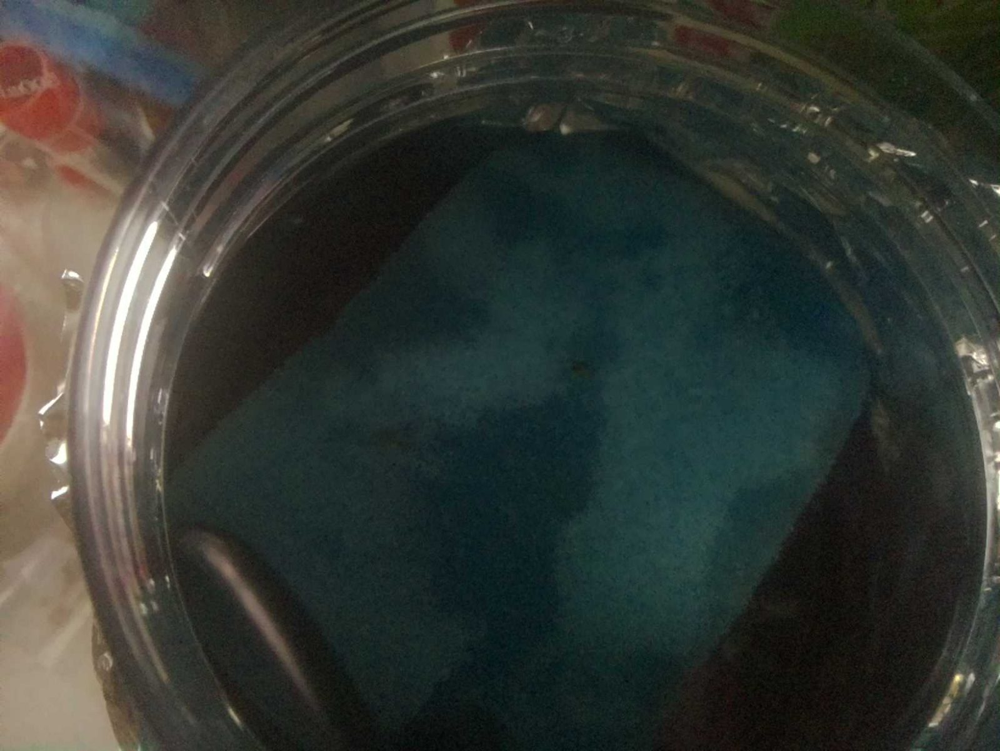
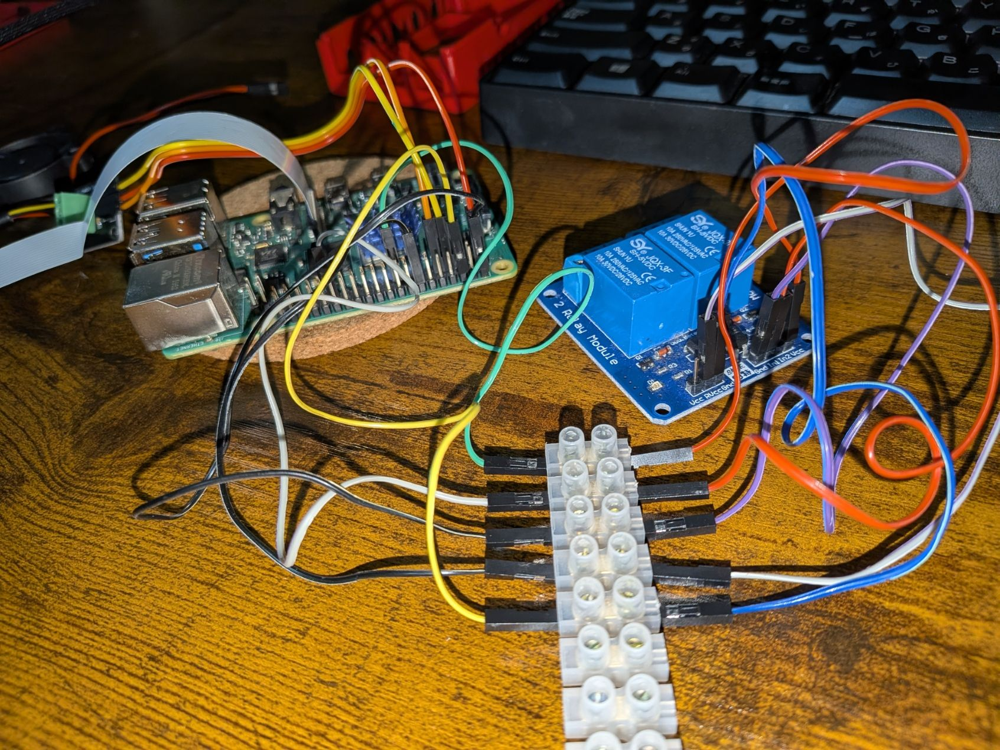

# Hydroponics

A long-term, hands-on hydroponics project in Nagaoka, Niigata. It starts as a single passive jar and grows, over years, into a heated, sensor-monitored, multi-crop system. This repo is the record: a log with photos, one file per crop run, and the notes and code behind the build.

<!-- status:start -->
**Current run:** [Run 1, Premium Ruby tomato](runs/2026-11-tomato-01.md) · active · day 8 · started 2026-11-19



_Latest photo: 2026-11-26 12:00 JST_
<!-- status:end -->

<!-- build:start -->
**Latest build step (2026-11-20): relay wired and working.** The 2-channel relay module is wired to the Pi (control on GPIO 5, active-low, off at boot). It clicks on and off from a button on the Pi's live camera page, switches itself off after 10 minutes, and turns off if the page stops. Next: a USB load test, then the heater. Every step so far: [build journal](docs/build-journal.md).


<!-- build:end -->

## How this repo updates

I post updates (text, photos, files) on my website, **Spoon Archive**, under *Projects → Hydroponic System 1*. A sync copies each post here automatically, so `log/` and `runs/` are never edited by hand. The exact format is in [docs/entry-format.md](docs/entry-format.md).

## Where things are

```
hydroponics/
├── README.md
├── log/                  # one folder per post: entry.md + photos (auto-synced)
│   └── 2026/2026-11-19-1558/
├── runs/                 # one file per crop run, start to finish (auto-synced)
├── docs/
│   ├── build-journal.md      # how the Pi rig was built, step by step, with photos
│   ├── entry-format.md       # format of posts and runs, and the sync contract
│   ├── heating-project.md    # the heater/thermostat project and its deadline
│   ├── crop-profiles.md      # what each crop needs
│   ├── bill-of-materials.md  # parts, costs, status
│   ├── parts-on-hand.md      # what I already own (controllers, sensors, relays)
│   ├── pi-setup.md           # setting up the Raspberry Pi, step by step
│   ├── device-api.md         # how the Pi talks to my website (data, photos, commands)
│   └── wiring-diagrams.md    # Pi, probe, relay, heater wiring and safety rules
├── hardware/             # CAD and printed parts (future)
├── firmware/             # Pi code: probe reader, live camera view
└── data/                 # sensor readings (future, not created yet)
```

## Roadmap

**Now (November 2026)**
- [x] Gather the jar, sponges, Hyponica A and B, and grow lamp
- [x] Choose seed: tomato (Premium Ruby). The basil packet was mouldy.
- [ ] Sow the tomato seeds in the sponge and set up the jar
- [ ] One photo and a short note every day

**Before 14 December 2026: heating project** (details and milestones in [docs/heating-project.md](docs/heating-project.md))
- [ ] DS18B20 probe reading on a Raspberry Pi
- [ ] Relay and 5 V USB heater switched by a thermostat script with hysteresis and a watchdog
- [ ] 7-day soak test in the real setup
- [ ] Remote check (Tailscale) and a camera photo working from outside the house

**Later**
- [ ] Move the tomato to a larger reservoir if it thrives
- [ ] More crops: basil again, then peppers, green beans, rosemary
- [ ] Sensor data logged to `data/` and shown on the website
- [ ] Active systems (air stone, recirculating) with ESP32 nodes

## Current setup (Run 1)

| | |
| :--- | :--- |
| Crop | Premium Ruby (プレミアムルビー), F1 cherry tomato |
| System | Kratky jar, 1.3 L, sponge medium |
| Nutrients | Hyponica liquid fertiliser A and B |
| Light | Grow lamp |
| Heating | None yet (in progress) |
