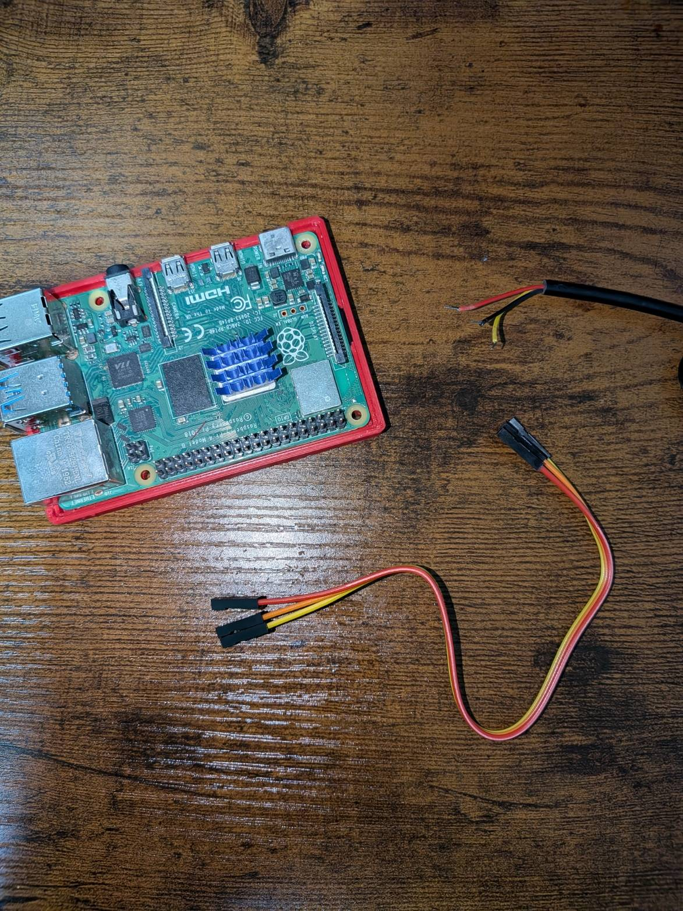
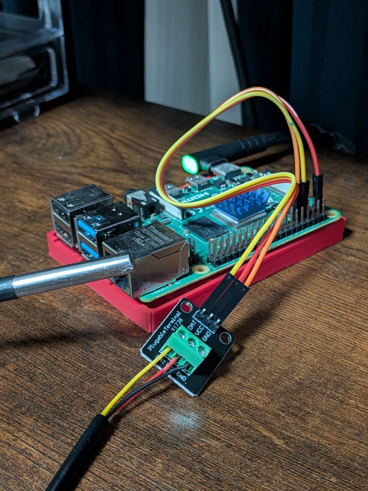
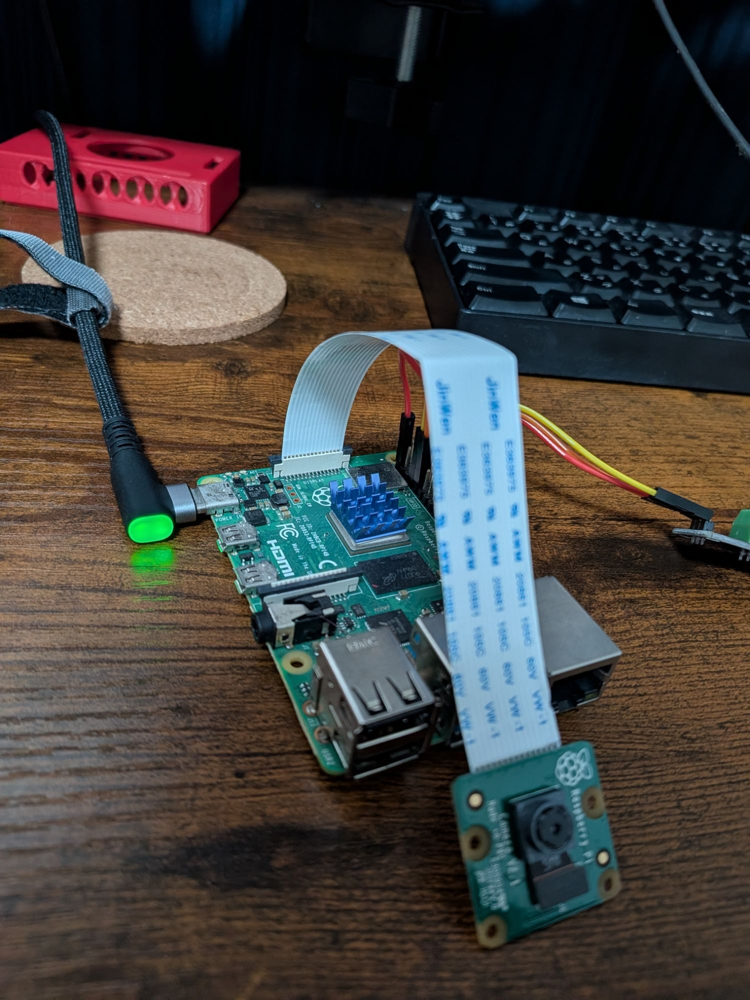
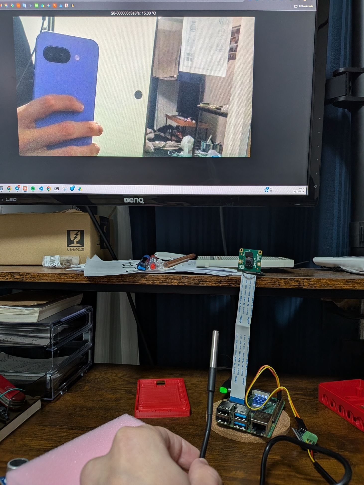
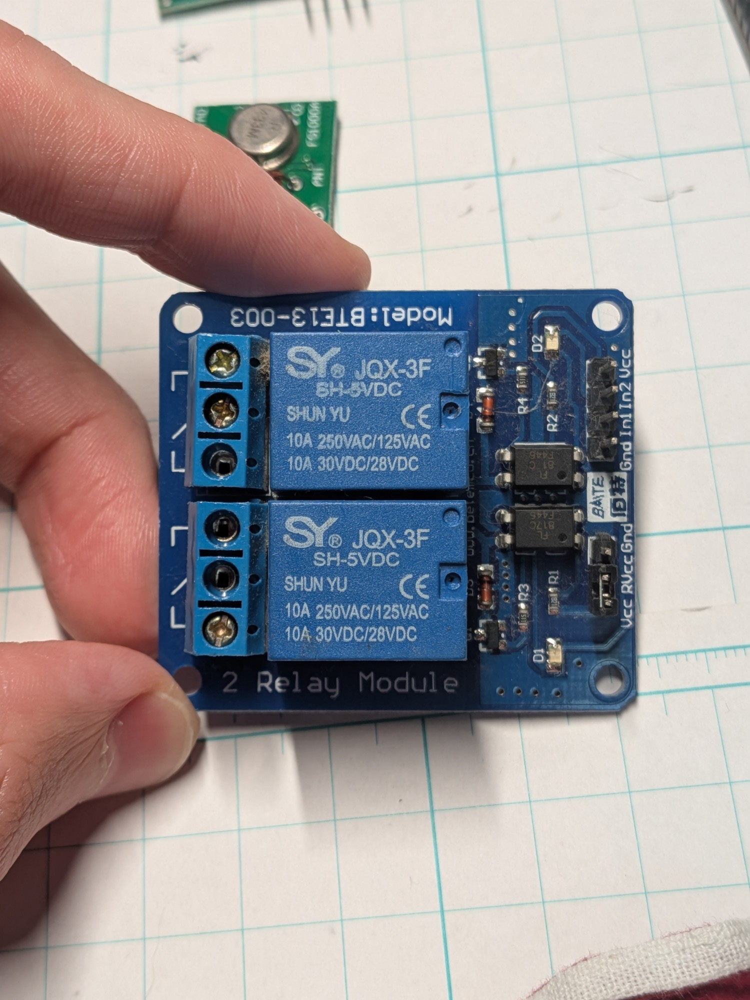
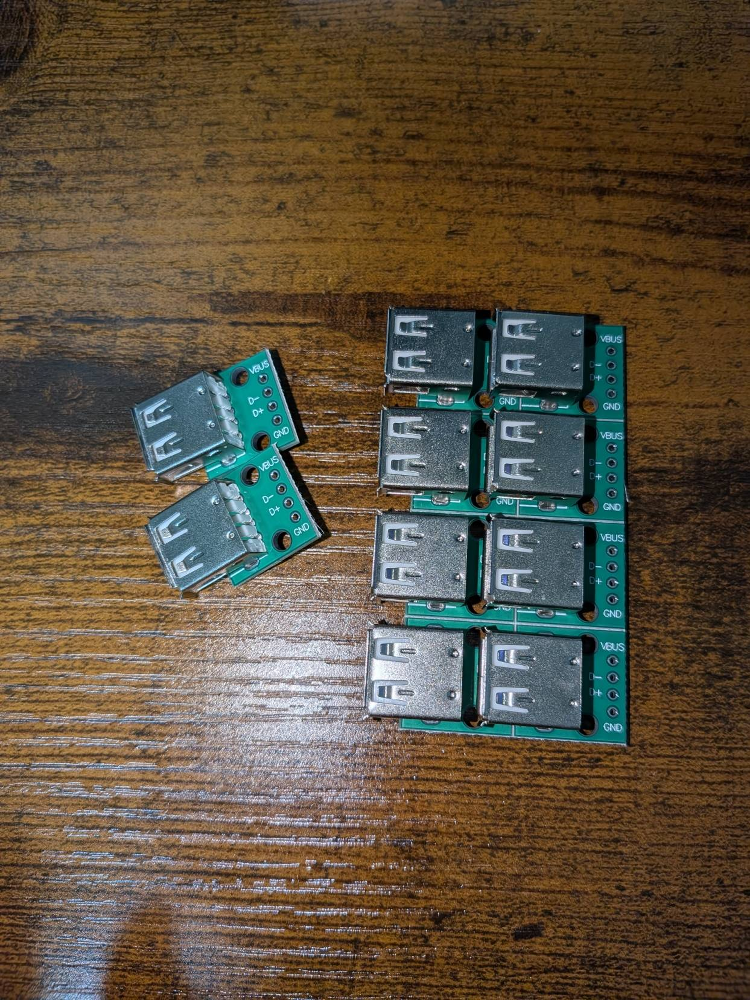
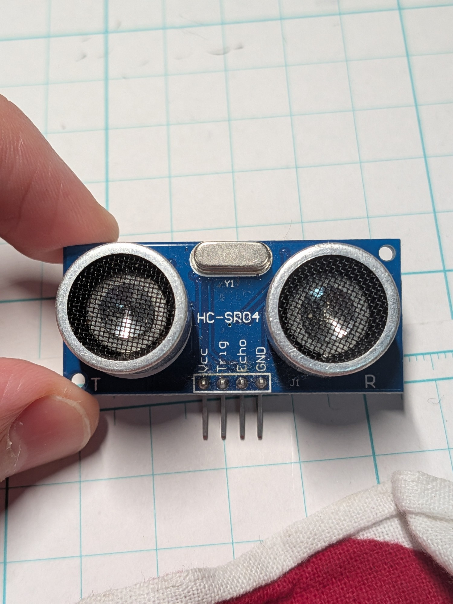
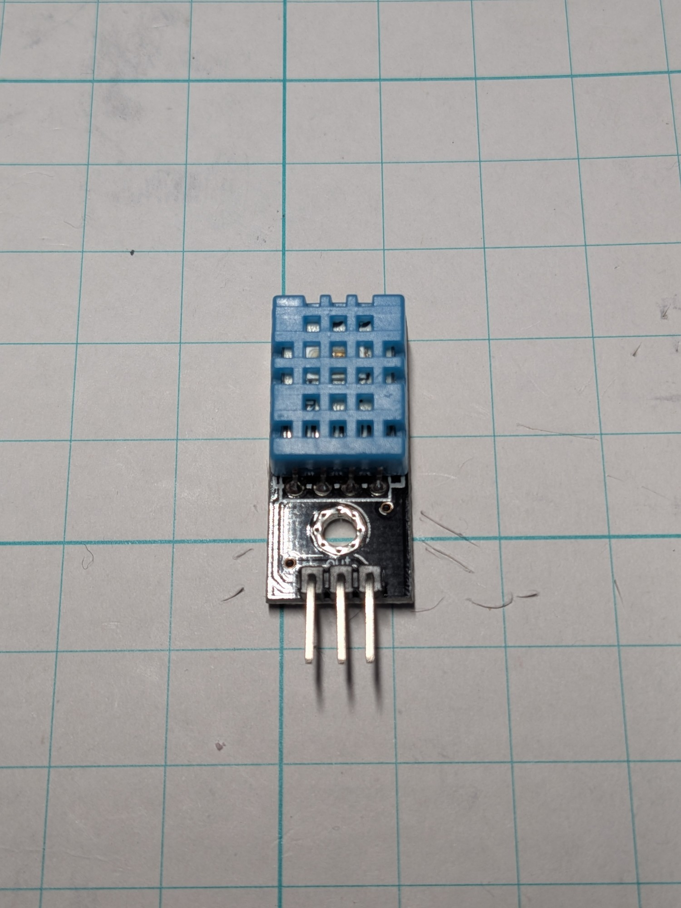

# Build journal: Pi rig

How the Raspberry Pi side of the build came together, step by step, with photos. Newest entries at the bottom. The grow itself is logged in `log/` and `runs/`; this file is only about the electronics and code.

---

## 2026-11-19: First water probe

The parts: the Pi 4 in its red printed case, one DS18B20 waterproof probe (bare red, black and yellow wires), and the 3-wire jumper lead from the probe's adapter board.

The probe needs a 4.7 kΩ pull-up resistor on its data line. The small "PlugableTerminal V1738" adapter board has one built in, so no soldering is needed. The probe's wires go into the green screw terminal (yellow to DAT, red to VCC, black to GND), and the adapter's header goes to the Pi:

| Adapter | Pi pin |
| :--- | :--- |
| VCC | Pin 1 (3.3 V) |
| DAT | Pin 7 (GPIO 4) |
| GND | Pin 9 (GND) |

On the Pi: added `dtoverlay=w1-gpio` to `/boot/firmware/config.txt` and rebooted. The probe showed up straight away as `28-000000d3a8fa`, reading 15.06 °C in the room. Holding the tip in a hand pushed it past 27 °C, so it reads live.

Software: `firmware/pi-thermostat/ds18b20.py` (reader) and `read_temp.py` (prints every probe every 2 s). Written by a Sonnet worker from the task board in 42 s, 10 tests.

Workflow set up the same day: the AI supervisor kit (Opus plans and checks, Sonnet and Haiku workers do the code and commands), and SSH key login so workers can reach the Pi without a password.

---

## 2026-11-20: Camera and live view

The Raspberry Pi Camera Module V2.1 (Sony IMX219 sensor). First attempt: not detected. The ribbon was in the **DISPLAY** slot (by the USB-C power port), not the **CAMERA** slot (between the micro-HDMI ports and the audio jack). Easy mistake: the two connectors look the same.

Moved to the CAMERA slot, silver contacts facing the HDMI ports: detected as `imx219`, and `rpicam-still` took a photo.

Then a live view, `firmware/timelapse-cam/live_view.py`: a small web server on the Pi that streams the camera with the probe temperature on top. Open `http://hydro-pi.local:8000` on any computer at home. It uses only what ships with Raspberry Pi OS (`rpicam-vid` plus Python's standard library), so nothing had to be installed. Written by a Sonnet worker in 56 s, 4 tests.

---

## Parts waiting for their turn

The heater switching parts, for when the heater arrives:

Two JQX-3F 5 V relays (contacts 10 A at 30 V DC, plenty for a 2 A heater), PC817 optocouplers on the inputs, and a jumper that separates the relay-coil supply (RVcc) from the logic supply (Vcc).

USB-A female breakouts (VBUS, D−, D+, GND), for plugging the heater's USB lead into the relay circuit.

Maybe later:

HC-SR04 ultrasonic sensor: a possible water-level sensor for a bigger reservoir. Its Echo pin outputs 5 V, so it needs a voltage divider before it goes to a Pi pin.

DHT11 module: air temperature and humidity around the plants.

---

## 2026-11-20: Camera controls, reboot and shutdown from the page

The live view page now has controls under the video (field of view, resolution, frame rate, brightness, contrast, saturation, sharpness, exposure, white balance, flip) and **Reboot** / **Shut down** buttons, so the Pi no longer needs SSH for everyday use. Settings are remembered on the Pi.

The page is a separate file (`firmware/timelapse-cam/web/index.html`) that talks to the Pi through a small JSON API, documented in [live-view-api.md](live-view-api.md), so it can move to the personal website later. A systemd service (`hydro-live-view`) starts the page at boot: a reboot from the page brings it back by itself in about 45 seconds.

Written by Sonnet workers (T4, T5) in about 3 minutes, 28 tests.
