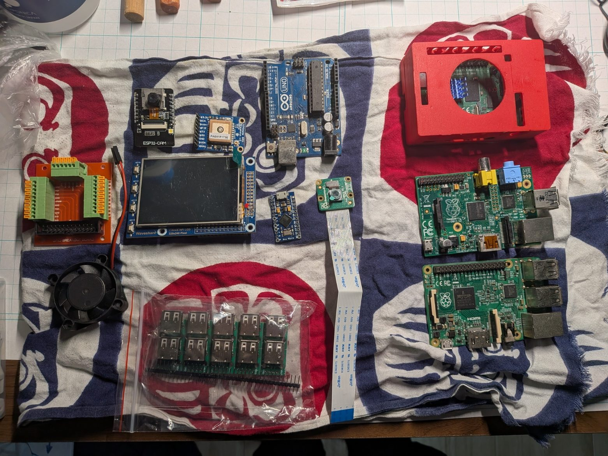

# Parts on hand (2026-11-19)

What I already own that could go into the build. Identified from photos on 2026-11-19. Anything marked "confirm" still needs checking against the board or part itself.

## Computers and controllers
| Item | Notes | Confirm |
| :--- | :--- | :--- |
| Raspberry Pi 4 Model B | Board marked "Raspberry Pi 4 Model B © 2018". Blue heatsink. Red 3D-printed case. USB-C power. | RAM size |
| Raspberry Pi, original Model B | Has RCA video and 2 USB ports. No Wi-Fi. Very slow, unlikely to be useful. | |
| Third Raspberry Pi | Looks like a Pi 3 Model B (4 USB, full-size HDMI, micro-USB power). | Model, printed on the board |
| Arduino Uno | ATmega328P in a socket. 5 V logic. | Works with a blink test |
| Pro Micro (ATmega32U4) | Micro-USB. Small. | 5 V/16 MHz or 3.3 V/8 MHz variant |
| ESP32-CAM | OV2640 camera, microSD slot, no USB port (needs a USB-serial adapter to program). | Whether I have a USB-serial adapter |

## Sensors and modules
| Item | Notes | Confirm |
| :--- | :--- | :--- |
| DS18B20 waterproof probes (2-pack) | Bought for this project. Not in the photos. | |
| Raspberry Pi Camera Module V2.1 + ribbon | Fits the Pi 4 and Pi 3. A protective film tab is still on the lens. | Peel the film before use |
| Ultrasonic distance sensor | Not photographed. Possible reservoir level sensor for a bigger container later. | Model |
| Soil/moisture sensor | Not photographed. Probably not needed. | Resistive or capacitive |
| Adafruit Ultimate GPS breakout v3 | Not needed for this project. | |
| Waveshare 2.8 inch RPi LCD (320×240, touch, 4 buttons) | Optional local display on a Pi. | |

## Switching and power
| Item | Notes | Confirm |
| :--- | :--- | :--- |
| Small 5 V relay modules (new, from Amazon) | For switching the 5 V USB heater. | Contact rating (heater needs about 2 A at 5 V), and whether the board has a driver transistor or optocoupler |
| Relays rated 10 A at 250 VAC / 125 VAC | Not photographed. Not needed. The heater is 5 V DC, so mains is not part of this build. | |
| USB Type-A female breakout boards (10-pack) | For wiring the heater's USB plug to the relay and power supply. | |
| Pi GPIO screw-terminal breakout board | Wires a Pi's 40-pin header to screw terminals without soldering. | |
| 40 mm fan | For Pi cooling if needed. | |
| Jumper wires | Plenty. | |

## Rule for this build
The heater is a 5 V DC device. Nothing in the heating project needs to touch mains voltage. Keep it that way.
