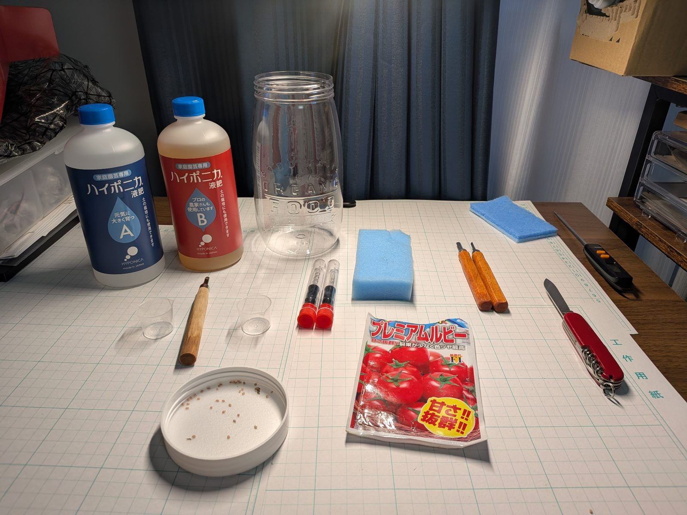
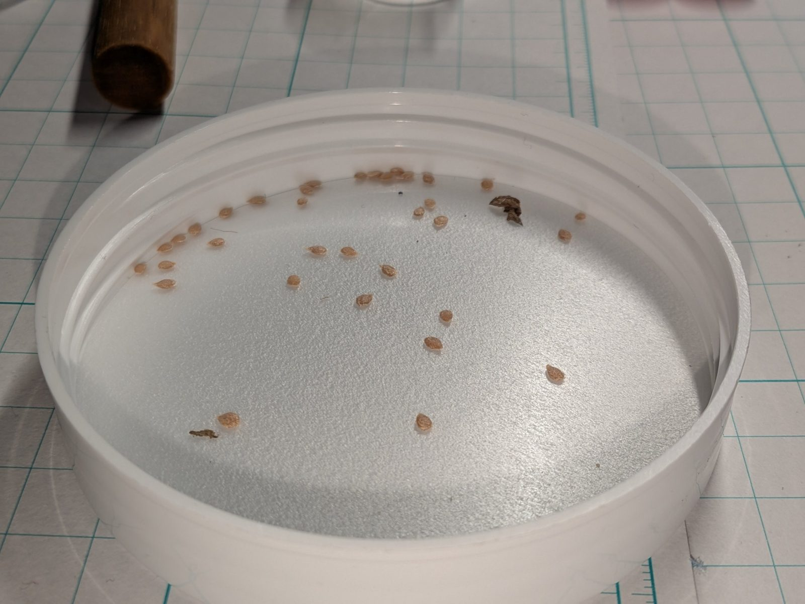

Started my first hydroponic system today.

I have everything I need: Hyponica A and B nutrients, a 1.3 L jar, sponges, and the lamp ready to go. I've cut a hole in the sponge for the seed.

I opened the basil seeds first and they were mouldy, so I'm not using them. The tomato seeds (Premium Ruby, プレミアムルビー) look fine, so I'm going with tomato.

The jar is about 1.3 L. That should be fine to start. It's my first time, so if it fails it's not the end of the world.

Next: put the seeds in the sponge and set everything up. Plan is one photo a day.

Deadline in the background: I fly to England on 14 December for about three weeks, so the heater and thermometer need to be working before then.

